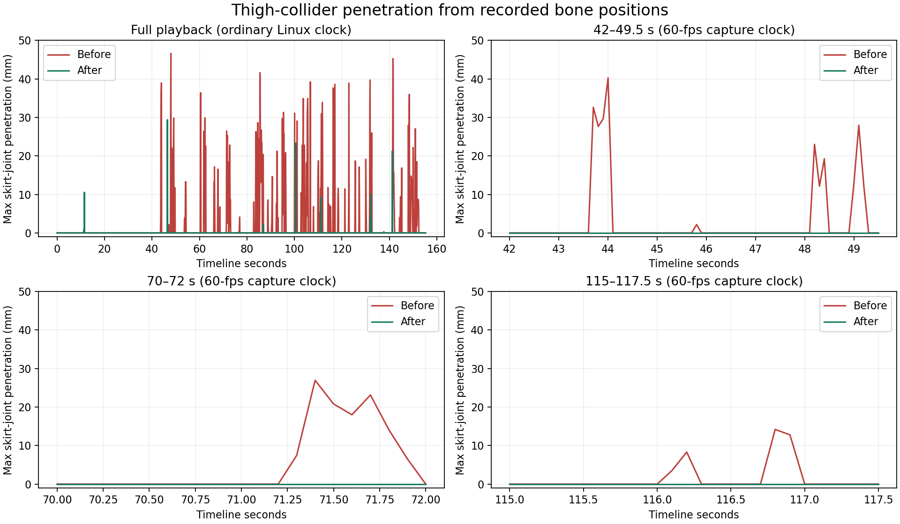

# Task L — skirt/thigh collision

## Result

Fixed a reconstruction error in the Quartz Euler conversion that drives the skirt roots. In three matched 60-fps playback windows, maximum sampled skirt-joint penetration fell from **40.3 / 26.9 / 14.2 mm to 0 mm**. The repaired method matches all **205 normalized APK 3.5.3 instructions**.

The slower full-live Linux scan improved substantially but retains overlaps. This is not a claim of zero mesh clipping throughout the live; the remaining intervals and Windows review are listed below.

All work is committed in `live-urp-codex`, branch `codex-f`. No tests were written or run, no Windows PC was accessed, no shared URP files were edited, and nothing was pushed.

## Cause and original-game fix

The game uses Quartz drivers to move skirt roots in response to the thighs, followed by Swing sphere/chain collisions and joint limits. `ActorAnimationMathUtility.ToEuler` calls `ThreeAxisRot`, then rearranges its three return components according to rotation order. Our reconstruction directly returned the helper for every order, omitting five rearrangements.

All eight skirt drivers in Temari's `cstm-0003` costume use XYZ. Its missing `.zyx` rearrangement exchanged the X/Z angles before the skirt's authored coefficients and limits were applied. Colliders were present and executing, but they operated below incorrectly driven skirt roots; subsequent angle limits could place skirt joints back inside the thighs.

Commit **`ece66b1`** restores the APK mapping:

| Order | Helper-result components returned |
| --- | --- |
| XYZ | z, y, x |
| XZY | z, x, y |
| YXZ | y, z, x |
| YZX | x, z, y |
| ZXY | y, x, z |
| ZYX | x, y, z — already correct |

APK `ToEuler` is at `0x657cb30`; the final rebuilt method is at `0x277e050`. Both contain the same 205 normalized instructions. The previous reconstruction had 182. [Raw APK assembly](Evidence/TaskL/to-euler-game.asm), [rebuilt assembly](Evidence/TaskL/to-euler-rebuilt.asm), [return-register audit](Evidence/TaskL/to-euler-review.md), and [comparison result](Evidence/TaskL/to-euler-comparison.json) preserve the evidence.

Task H's earlier explanation of this semantic flag as equivalent dispatch/helper inlining was incorrect. Untyped Hex-Rays output hid the return-register shuffles. The comparison tool's full normalized instructions retain these moves, while its semantic summary omits them; that summary was insufficient to establish equivalence.

This shared helper also affects other Quartz drivers, including hair. No capsule dimensions, masks, authored coefficients, limits, collision iterations or physics time-step behavior were changed.

## Physics-path audit

The loaded rig contains **186 dynamic bones, 25 static colliders and 69 chain segments**. Body authoring supplies 90 dynamic bones, 24 statics, eight Skirt drivers, four HumanoidUpLeg drivers and two chain components. Hair adds 96 dynamic bones, ten Hair drivers and one chain; the face adds one static collider. This costume has no Waist driver or SimpleBone component.

The UpLeg capsules and knee-to-hip Line capsules are registered with matching short/long-skirt masks. The signed negative capsule half-heights are authored data and are correctly preserved. Static collider transforms update with the body: at the inspected 65.006-second sample, job positions and positions reconstructed from completed-frame transforms differ by approximately 1e-7 m. Recorded dynamic and skirt-chain hit counts confirm collision processing. The job order remains IK → limits/constraints → Quartz → Swing, with static colliders updated before dynamic bones.

The motion disables seated correction, and the timeline disables common-height normalization; observed root scale is one. Registration/sorting, root cancellation, reset/prewarm and lateral-chain paths were inspected against the existing native reconstruction evidence. No additional live-path defect was established. [Body authoring](Evidence/TaskL/body-authoring.json), [scene settings](Evidence/TaskL/scene-physics-settings.json), the pose extracts and comparison census retain the audit inputs.

The expanded census explicitly retains dormant stubs rather than claiming they are implemented: separate SimpleBone MonoBehaviour paths, legacy ActorSwingGroup, non-Campus generic jobs, and three configuration entry points without a native direct caller or reconstructed live caller. See [census scope](Evidence/TaskL/census-scope.json) and [direct-call evidence](Evidence/TaskL/nonlive-direct-callers.json). Direct-call absence alone does not exclude reflection or virtual dispatch.

## Measured before/after behavior

The optional host recorder copies completed bone transforms and existing job state without evaluating or modifying the animation graph. Measurements reconstruct the thigh collision shapes in world space, respect their masks and measure skirt-joint centres against the nearest axis point and interpolated capsule radius. All skirt sphere offsets in this costume are zero. A separate metric includes the dynamic sphere radius.

These are collision-proxy measurements, not mesh-triangle intersection counts. [Measurement definitions](Evidence/TaskL/measurement-method.md), [summary](Evidence/TaskL/measurement-summary.json), eight CSV files and [representative raw poses](Evidence/TaskL/representative-poses.json.gz) make the numbers reviewable. Full raw traces remain under `.recon/task-l/` with hashes in the build record.

For the matched captures, Unity's capture clock advances the unchanged solver at 60 evaluations per second. Samples are approximately 0.1 seconds apart. Before/after timestamps match exactly, and recorded Hips/UpLeg/Leg world positions are identical across each pair.

| Timeline window | Samples per run | Max joint penetration before → after | Max sphere overlap before → after | Samples with joint penetration >1 mm before → after |
| --- | ---: | ---: | ---: | ---: |
| 42.0–49.5 | 76 | **40.252 → 0 mm** | 55.252 → 0.651 mm | 11 → 0 |
| 70.0–72.0 | 21 | **26.948 → 0 mm** | 41.948 → 0 mm | 7 → 0 |
| 115.0–117.5 | 26 | **14.192 → 0 mm** | 32.780 → 0 mm | 4 → 0 |

The joint-penetration peaks occur at **44.0**, **71.4**, and **116.8** seconds, respectively, on `RightFrontSkirt3_S_End` against the right thigh Line collider. The final 0.651-mm sphere overlap in the first window does not put the joint centre inside the thigh.

The full ordinary-clock passes recorded 1,551 before and 1,550 after samples. Maximum joint penetration changed from **46.608 mm at 47.964 s** to **29.385 mm at 46.478 s**; samples exceeding 1 mm fell from **224 to 11**. Maximum sphere overlap changed from 68.593 to 59.385 mm. These slower runs usually advance animation by 0.1 seconds per evaluation, and their sample timestamps are not identical.



### Residuals and reference frames

The full-scan residuals above 1 mm occur near **11.52, 46.48, 86.90, 100.55, 110.97–111.17, 131.90–132.20 and 141.21 seconds**. The largest is a long-skirt joint against the opposite thigh. The original solver advances once per graph evaluation; it does not add substeps to compensate for the slow Linux clock. The 60-fps window covering 46.48 has no sampled joint penetration, demonstrating cadence dependence there. Other residual intervals were not all recaptured at 60 fps, so their cause and Windows appearance are not claimed resolved. No compensating collision behavior was invented.

The live's stronger lifts include roughly 62.0–63.0 seconds, the deep bend around 111.0–111.2, the 116.2–116.5 bend, and 131.9–132.1. The full trace's hip-to-knee elevation reaches approximately 99° near 111.1 seconds. These timings come from recorded motion, not pixel inference.

[Before/after/DMM frame pairs](Evidence/TaskL/visible-frame-pairs.jpg) cover timeline **71.2, 71.4 and 71.6**; corresponding DMM recording times are **68.1, 68.3 and 68.5**, using the required +3.1-second mapping. Individual PNGs are retained, including [before 71.4](Evidence/TaskL/before-71.4.png), [after 71.4](Evidence/TaskL/after-71.4.png), and [DMM 71.4](Evidence/TaskL/dmm-71.4.png).

The stipulated reference pairs still differ in camera framing, lighting and visible pose. They provide context for PC review, not pixel-equivalence evidence. DMM supplies no bone/collider telemetry, so no numeric DMM penetration is claimed.

## Builds, comparison and provenance

The last runtime-source commit is **`7d497cd`**. Both Linux and Android were rebuilt after that source change, before the final comparisons. Linux reports `LIVE_BUILD Succeeded errors=0`. Android C# and native IL2CPP compilation complete; Gradle packaging reaches the pre-existing `lintVitalAnalyzeRelease` / `For input string: "37.0"` failure. The comparisons use the newly produced arm64 library.

| Census | Same normalized instructions | Layout flags | Semantic flags | Only in game | Re-signed |
| --- | ---: | ---: | ---: | ---: | ---: |
| F | 631 | 35 | 39 | 0 | 0 |
| H expanded | 1272 | 139 | 140 | 125 | 0 |
| I | 252 | 23 | 40 | 0 | 0 |
| J | 90 | 20 | 19 | 0 | 0 |
| K | 5 | 1 | 1 | 0 | 0 |
| L broad audit | 370 | 59 | 115 | 12 | 0 |

F/I/J/K flags and all previous missing-name lists are unchanged. H resolves `ToEuler` and the prior `InitializeExpression` attribution flag. Its two new/reclassified flags are unchanged-source metadata-load scheduling in `InitializeCampusMaterials`, and a linker thunk in `CampusDirectorControlAsset.CreatePlayable`. The thunk at `0x50a7664` loads the original metadata pointer and returns to `0x4e1d01c`. [Parity review](Evidence/TaskL/parity-review.json) and raw diffs preserve these findings. Full-library instruction equivalence is not claimed.

L's 556-name broad audit includes 68 dormant names. Its 488 runtime-family names have 369 same / 56 layout / 63 semantic / 0 missing. Family membership does not mean every method runs in this costume. `LAYOUT.md`, `LAYOUT-ALL.md`, and `Tools/build-artifacts.json` were restored after the dump.

All eight successful recordings reach `LIVE_STOPPED` and `LIVE_QUIT`, with zero logged exceptions, graphics-buffer-finalizer warnings or undisposed-culling-group warnings. They produce 60 total screenshots. Known Linux video-decoder/missing-script messages remain. All runs used `--mute -noaudio`, `SDL_AUDIODRIVER=dummy` and `PULSE_SERVER=unix:/nonexistent`.

The paired baseline uses the final recording host with **both** the preserved original `ActorAnimation.Runtime.dll` and original `lib_burst_generated.so`. An initial capture setup mistakenly shared the new Burst library; those captures were excluded and the baseline pairs repeated. Only the corrected pairs appear in the committed measurements. [Build inputs](Evidence/TaskL/build-inputs.json) records both versions, content/native/recording hashes, logs and capture counts; [build summary](Evidence/TaskL/build-summary.txt) records compilation outcomes.

Source commits: `cdeb467` adds read-only recording, `ece66b1` fixes the game helper, and `7d497cd` adds bounded capture-clock controls and explicit chain hit recording. `86f6119` was the quota handoff; the final evidence/report commit follows it.

## Claude's PC handoff

Copy the updated `ActorAnimationMathUtility.cs` in `Packages/ActorAnimation.Runtime`. If copying the host additions, include `LiveHost.cs`, `LiveOptions.cs`, `LivePoseRecorder.cs`/metadata and `TrueEnd.Host.asmdef`. Rebuild the Windows player with `LiveBuild.BuildWindows`, including **fresh IL2CPP and Burst output**; reusing Task K's Burst binary would retain the defect.

Original content and the shared URP fork need no changes. The existing Windows content archive remains reusable (SHA-256 `d3267c0fa3a97c95215e7ba457cced42db1b19e2b373e56a4df18f414a13a291`).

Review skirt behavior at normal playback cadence around **43.6–44.0, 47.8–49.0, 71.2–71.8 and 116.0–116.9 seconds**. Also inspect the stronger lifts and residual intervals listed above, especially **111, 132 and 141.2 seconds**. Confirm the rebuilt Windows cloth/leg appearance against the DMM recording; Linux proxy measurements do not replace that visual review. The shared Euler fix also changes other Quartz-driven bones, so include hair and knee/arm auxiliary motion in that review.

For a reproducible silent Linux capture of the visible window:

```sh
env SDL_AUDIODRIVER=dummy PULSE_SERVER=unix:/nonexistent LIBGL_ALWAYS_SOFTWARE=1 \
  xvfb-run -a -s '-screen 0 640x360x24' Build/Linux/TrueEnd.x86_64 \
  -force-vulkan -force-device-index 0 -noaudio \
  -screen-width 640 -screen-height 360 -screen-fullscreen 0 \
  --sample ttmr001 --data "$PWD/Build/Content-Linux/ttmr001" --mute \
  --capture-fps 60 --start-time 70 --stop-time 72 --quit-after 1800 \
  --pose-log "$PWD/.recon/task-l/after-visible-poses.jsonl" \
  --screenshots 71,71.2,71.4,71.6 \
  --capture-dir "$PWD/.recon/task-l/after-visible" \
  -logFile "$PWD/.recon/task-l/after-visible.log"
```

Saved-recording analysis uses `python3 Evidence/TaskL/measure_poses.py recording.jsonl measurements.csv`; it does not execute physics or assert expected results.
